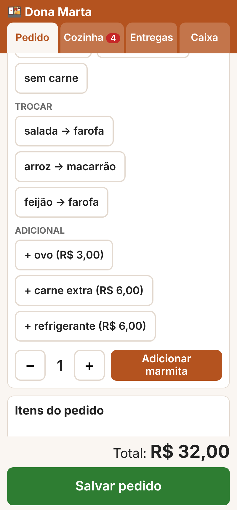
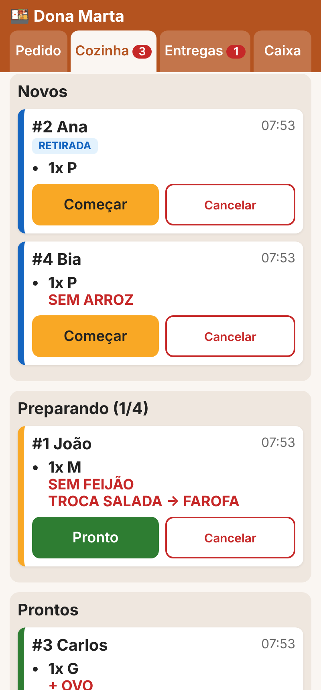
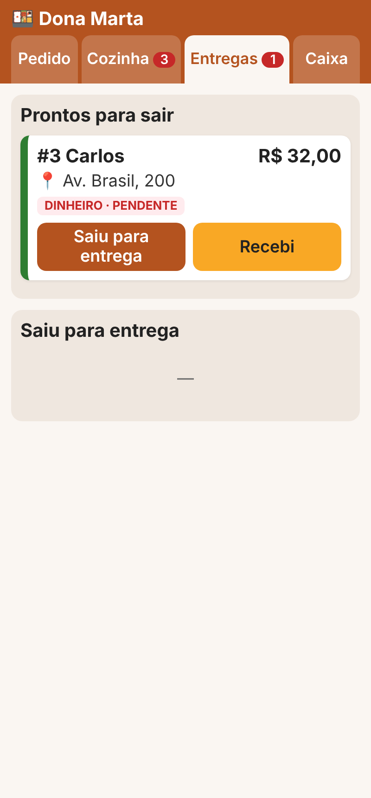
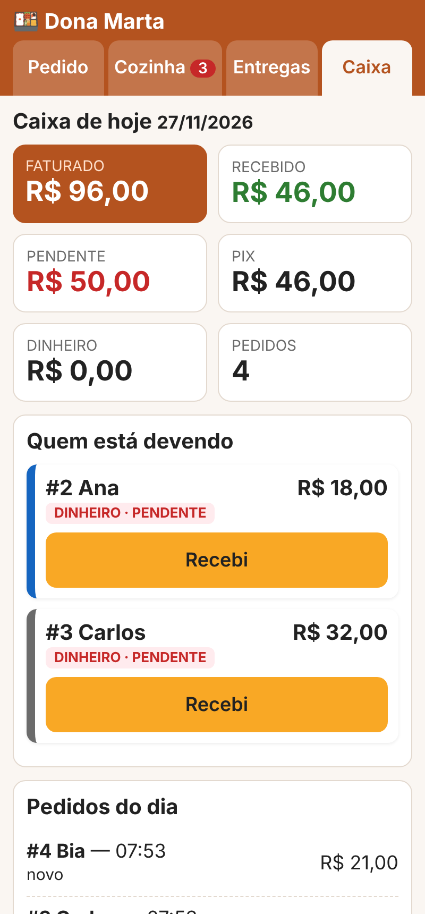

# 🍱 Marmitaria da Dona Marta

Web App que organiza os pedidos de uma marmitaria de bairro no **horário de pico (11h–13h)**. Ele resolve o caos dos pedidos soltos no WhatsApp ("sem feijão", "troca salada por farofa", "manda no endereço de sempre", "pago no Pix").

Roda direto no navegador (celular ou computador), **sem instalar nada e sem internet**. Os dados ficam salvos no próprio navegador (LocalStorage).

| Novo pedido | Cozinha | Entregas | Caixa |
|---|---|---|---|
|  |  |  |  |

## ▶️ Como usar

**Opção 1 — direto no computador:** baixe o projeto e abra o arquivo `index.html` no navegador.

**Opção 2 — no celular (GitHub Pages):** em *Settings → Pages*, escolha a branch `main` e a pasta `/ (root)`. O app fica em `https://SEU-USUARIO.github.io/marmitaria-dona-marta/`.

### Fluxo
1. **Pedido:** busque o cliente (o endereço "de sempre" é preenchido sozinho), escolha o tamanho, toque nas personalizações e salve.
2. **Cozinha:** a fila aparece em ordem de chegada, com as personalizações em vermelho. Use **Começar → Pronto**. A coluna *Preparando* avisa quando passa de 4 pedidos (limite de WIP).
3. **Entregas:** mostra endereço e se o pedido está pago. Use **Saiu → Entregue** (ou **Cliente retirou**) e **Recebi**.
4. **Caixa:** mostra o faturado, o recebido e o pendente do dia, separados por Pix e dinheiro, e a lista de quem está devendo.

## 🧪 Testes automatizados (TDD)

Precisa do **Node.js 18 ou mais novo**. Não há dependências para instalar.

```bash
npm test        # ou: node --test
```

São **41 testes**, escritos antes do código (ciclo Red → Green → Refactor, visível no histórico de commits). Eles cobrem as regras críticas:

| Regra | Arquivo de teste |
|---|---|
| Cálculo de valores (tamanho, quantidade, adicionais, taxa de entrega, centavos) | `tests/pedido.test.js` |
| Personalizações (sem / troca / adicional, repetição, conflitos, itens fora do cardápio) | `tests/pedido.test.js` |
| Limite de WIP da cozinha | `tests/pedido.test.js` |
| Mudança de status (fluxo de entrega x retirada, sem pular etapas, cancelamento) | `tests/entrega-caixa.test.js` |
| Soma do caixa (total, recebido, pendente, Pix x Dinheiro, cancelados, devedores) | `tests/entrega-caixa.test.js` |

## 📁 Estrutura

```
index.html                 telas do app
css/style.css              visual (botões grandes, pensados para a cozinha)
js/regras.js               regras de negócio puras (testadas)
js/app.js                  interface + LocalStorage
tests/                     testes automatizados (node:test)
docs/01-jornada.md         Design Sprint: mapa da jornada e gargalos
docs/02-prototipo-e-teste.md  esboços de tela + relato do teste com usuários
docs/03-backlog-e-sprints.md  Product Backlog, WIP, DoD e Sprints
```

> As regras ficam separadas da tela (`regras.js`). Por isso são fáceis de testar, e a própria interface usa as regras para desabilitar personalizações que conflitam.

## 🗂️ Entregáveis do desafio

1. **Descoberta (Design Sprint):** [mapa da jornada](docs/01-jornada.md) · [esboços e relato do teste](docs/02-prototipo-e-teste.md)
2. **Gestão ágil (Scrum + Kanban):** [backlog, WIP e sprints](docs/03-backlog-e-sprints.md) · Quadro: ✏️ *link do GitHub Projects/Trello*
3. **Engenharia (XP):** app funcional + 41 testes + histórico de commits incremental (`git log --oneline`)
4. **Transparência no uso de IA:** seção abaixo

---

## 🤖 Transparência no uso de IA

### Como a IA foi usada (copiloto)
Usei o **Claude (Anthropic)** como copiloto de desenvolvimento. Todos os commits gerados com ajuda da IA trazem a marcação `Co-Authored-By: Claude` no histórico do git. A IA:
- fez o rascunho do mapa da jornada, dos esboços de tela e do backlog em Histórias de Usuário a partir do enunciado;
- escreveu os testes antes do código (TDD) e depois a implementação das regras e das telas;
- testou o app em um navegador automatizado e tirou os prints das telas.

### Decisões de produto que foram minhas
> ✏️ **PREENCHER** com o que você decidiu, aceitou, mudou ou rejeitou. Exemplos de perguntas para guiar:
- Quais tamanhos, preços, ingredientes e adicionais o cardápio tem? (ajustar em `js/regras.js` → `CARDAPIO`)
- O que entrou na Sprint 1 e o que entrou na Sprint 2, e por quê?
- O que mudou depois do teste com as 2 pessoas?
- _______

### Erros e limitações da IA que precisei corrigir
> ✏️ **PREENCHER** com o que você encontrou e corrigiu ao revisar ou testar o app.

Problemas que apareceram durante o desenvolvimento com a IA (registrados no histórico):
- O script de teste `node --test tests/` não funcionava no Node 22 (o comando não aceita pasta). Foi corrigido para `node --test`.
- Um pedido de retirada não pago sumia da tela de Entregas quando era marcado como "Cliente retirou". Foi adicionado um aviso, e o pedido fica na lista de devedores do Caixa.

### Limitações conhecidas (ainda não resolvidas)
- Os dados ficam só no navegador daquele aparelho: não sincronizam entre celular e computador, e limpar o navegador apaga tudo.
- O cardápio é fixo no código (história US11 no backlog).
- Não há histórico de dias anteriores, só o caixa do dia atual (história US12).
- Os pedidos ainda são digitados à mão a partir do WhatsApp; não existe integração automática.
